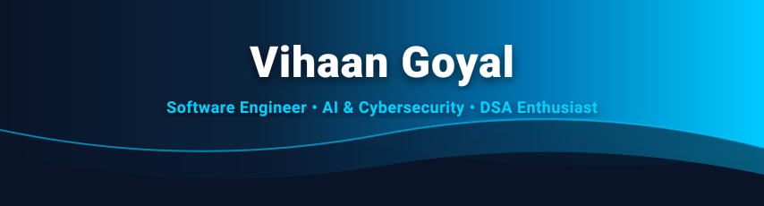

<div align="center">

  <!-- Header Banner -->
  <a href="https://github.com/VihaanGoyal12">
    
  </a>

  <!-- Animated Typing Tagline -->
  <a href="https://github.com/VihaanGoyal12">
    
  </a>

  <!-- Quick Stat Badges & Profile Views -->
  <p align="center">
    
    
    
    
  </p>

  <!-- Social Links -->
  <p align="center">
    <a href="https://linkedin.com/in/vihaangoyal31" target="_blank">
      
    </a>
    <a href="https://leetcode.com/u/VihaanGoyal31/" target="_blank">
      
    </a>
    <a href="https://www.geeksforgeeks.org/profile/vihaangoyal31" target="_blank">
      
    </a>
    <a href="mailto:vihaangoyal31@gmail.com">
      
    </a>
    <a href="https://instagram.com/vihaangoyal31" target="_blank">
      
    </a>
  </p>

</div>

<br/>

<!-- ============================================== -->
<!-- ABOUT ME SECTION -->
<!-- ============================================== -->

## ⚡ About Me

```typescript
const vihaanGoyal: SoftwareEngineer = {
  education: "B.Tech in Computer Science & Engineering",
  strengths: ["Data Structures & Algorithms", "Full-Stack Development", "AI/ML Systems", "Cybersecurity"],
  currentFocus: "SIH 2026 Cybersecurity & Agentic AI Systems",
  metrics: {
    dsaSolved: "550+ Problems (LeetCode & GFG, primarily Java)",
    favoriteLanguages: ["Java", "JavaScript", "Python", "TypeScript"],
    architectureStyle: "Clean, Scalable, Resilient & Modular"
  },
  mindset: "Build. Learn. Solve. Repeat."
};
```

- 🏴 **Currently Working On**: A high-impact network threat intelligence & cybersecurity system for **SIH 2026**.
- 🫱🏻‍🫲🏻 **Open To Collaborate On**: Applied AI, full-stack systems, security tools, and hackathon projects.
- 🤝 **Focus Areas**: Advanced DSA, distributed architectures, machine learning pipelines, and network telemetry.
- 🌱 **Continuously Leveling Up**: Graph algorithms, Kafka event streaming, deep learning models, and security protocols.
- ⚡ **Fun Fact**: Conquered **550+ DSA problems** across LeetCode & GeeksforGeeks.

<br/>

<!-- ============================================== -->
<!-- TECH STACK & TOOLS -->
<!-- ============================================== -->

## 🛠️ Tech Stack & Arsenal

<div align="center">
  <!-- Interactive Dynamic Icon Ribbon -->
  <a href="https://skillicons.dev">
    
  </a>
</div>

<br/>

<table align="center" width="100%">
  <tr>
    <td width="50%" valign="top">
      <h4>💻 Languages</h4>
      <p>
        
        
        
        
        
        
        
      </p>
      <h4>🌐 Development & Web</h4>
      <p>
        
        
        
        
        
        
      </p>
    </td>
    <td width="50%" valign="top">
      <h4>🤖 AI, Data & Telemetry</h4>
      <p>
        
        
        
        
      </p>
      <h4>🛡️ Cybersecurity & Tooling</h4>
      <p>
        
        
        
        
      </p>
    </td>
  </tr>
</table>

<br/>

<!-- ============================================== -->
<!-- FEATURED PROJECTS -->
<!-- ============================================== -->

## 🚀 Featured Projects

### ⚡ [Pulse](https://github.com/VihaanGoyal12/Pulse)
> **AI-Powered Engineering Issue Triage & Automation**

An AI-assisted system that analyzes engineering issues, classifies them, routes them to the appropriate team, and leverages confidence-based automation with human review.

- **Tech Stack:** `JavaScript` · `Google Gemini API` · `GitHub API` · `Slack` · `Notion`
- [](https://github.com/VihaanGoyal12/Pulse)

---

### 🤖 [Aegis AI](https://github.com/VihaanGoyal12/AegisAi)
> **AI Executive Assistant**

An intelligent assistant integrating Gmail, Google Calendar, and Notion to deliver prioritized briefings, multi-source context, and automated scheduling conflict detection.

- **Tech Stack:** `Node.js` · `Google Gemini` · `Swytchcode` · `REST APIs`
- [](https://github.com/VihaanGoyal12/AegisAi)

---

### 🔐 [UniDetect / IPsecAI](https://github.com/VihaanGoyal12/IPsecAI)
> **Next-Gen Network Telemetry & Threat Detection (SIH 2026)**

A cybersecurity initiative focused on passive network traffic analysis, packet anomaly detection, and ML-driven security policy enforcement.

- **Tech Stack & Exploration:** `Python` · `Zeek` · `TShark` · `XGBoost` · `Apache Kafka` · `FastAPI`
- [](https://github.com/VihaanGoyal12/IPsecAI)

---

### 📈 [EquiWatch](https://github.com/VihaanGoyal12/EquiWatch)
> **High-Performance Equity Analytics & Monitoring**

Real-time equity market tracking, telemetry dashboards, and financial analytics engine.

- **Tech Stack:** `TypeScript` · `React` · `Node.js` · `Financial APIs`
- [](https://github.com/VihaanGoyal12/EquiWatch)

<br/>

<!-- ============================================== -->
<!-- GITHUB & PROBLEM SOLVING METRICS -->
<!-- ============================================== -->

## 📊 Analytics & Coding Activity

<div align="center">
  <table border="0">
    <tr>
      <td align="center" width="50%">
        
      </td>
      <td align="center" width="50%">
        
      </td>
    </tr>
    <tr>
      <td align="center" width="50%">
        <br/>
        <a href="https://leetcode.com/u/VihaanGoyal31/" target="_blank">
          
        </a>
      </td>
      <td align="center" width="50%">
        <br/>
        <a href="https://www.geeksforgeeks.org/profile/vihaangoyal31" target="_blank">
          
        </a>
      </td>
    </tr>
  </table>
</div>

<br/>

<!-- ============================================== -->
<!-- FOOTER & INSPIRATION -->
<!-- ============================================== -->

<div align="center">

  <h3>💡 Build. Learn. Solve. Repeat.</h3>

  <p align="center">
    <i>"Any fool can write code that a computer can understand. Good programmers write code that humans can understand."</i><br/>
    — <b>Martin Fowler</b>
  </p>

  <p align="center">
    ⚡ <b>Let's connect:</b> <a href="mailto:vihaangoyal31@gmail.com">vihaangoyal31@gmail.com</a> • <a href="https://linkedin.com/in/vihaangoyal31">LinkedIn</a> • <a href="https://leetcode.com/u/VihaanGoyal31/">LeetCode</a>
  </p>

  <br/>

  <a href="https://github.com/VihaanGoyal12">
    
  </a>

  <br/>
  
  <p align="center">
    <a href="#-about-me">⬆️ Back to Top</a>
  </p>

</div>

